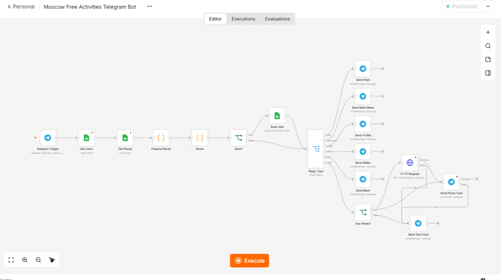

# Moscow Free Activities Telegram Bot

## Overview
I built a Telegram bot using n8n to help people discover free things to do in Moscow.

The project uses a visual automation workflow without writing a custom backend.

## Problem
Finding free activities and places to visit in Moscow can take time. This bot aims to make discovering activities easier through Telegram.

## Tools Used
- n8n
- Telegram Bot API
- Workflow Automation

## How It Works
1. The user interacts with the Telegram bot.
2. The bot presents available options.
3. The workflow processes the user's selection.
4. The bot sends relevant information back to the user.

## Workflow
The automation is built using n8n nodes and connected into a single workflow.
### Workflow Screenshot
### Workflow JSON

[Download the n8n workflow (JSON)](Moscow_Free_Activities_Telegram_Bot_Sanitized.json)

## What I Learned
- Building Telegram bots with n8n
- Workflow logic and automation
- Handling Telegram interactions
- Connecting services through APIs

## Project Status
Personal project.

