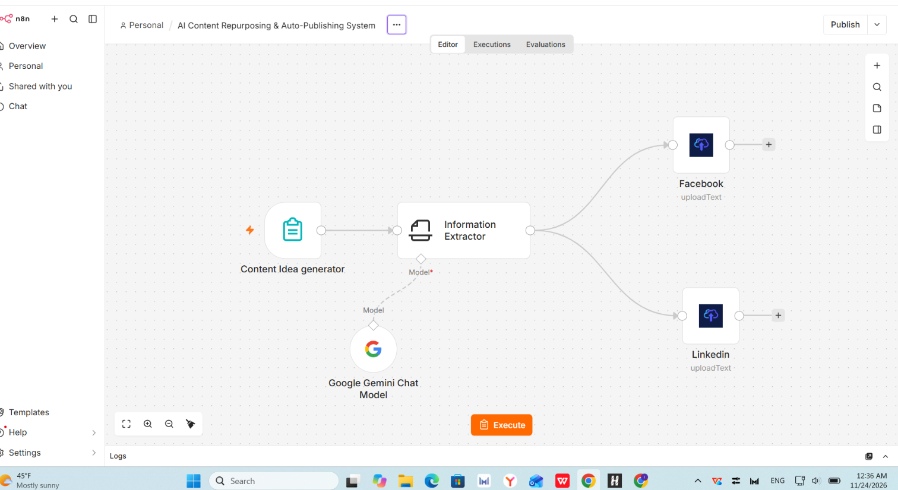

# AI Content Repurposing & Auto-Publishing System

## Overview
An n8n automation workflow that transforms a user's content idea into platform-specific social media captions using AI and publishes them to Facebook and LinkedIn.

## Problem
Creating content separately for multiple social media platforms takes time. This workflow automates content generation and publishing from a single idea.

## Tools Used
- n8n
- Google Gemini AI
- Upload-Post
- Facebook
- LinkedIn
- AI Information Extractor

## How It Works
1. User submits a content idea through an n8n form.
2. Gemini AI analyzes the idea and extracts content information.
3. AI generates platform-specific captions.
4. The workflow sends the content to Facebook.
5. The workflow sends the content to LinkedIn.

## What I Learned
- AI-powered content generation
- Multi-platform content automation
- Connecting AI models with n8n
- Social media publishing integrations
- Workflow automation

## Project Status
Personal automation project.
## Workflow Screenshot

## Workflow File

[Download n8n Workflow JSON](AI_Content_Repurposing_Auto_Publishing_Sanitized.json)
